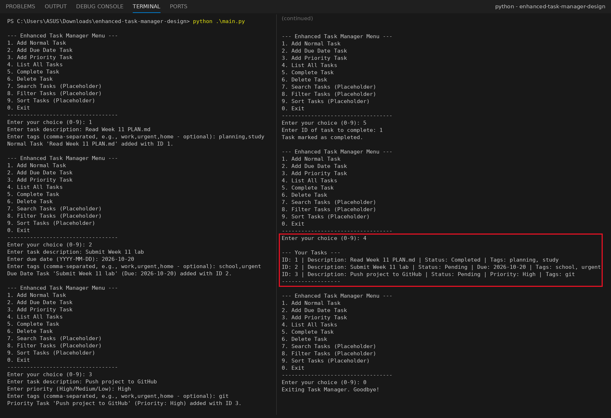

# Enhanced Task Manager Design (Week 11 Scaffold)

ผู้จัดทำ: เมธาวี สิทธิชัยเนตร, รหัสนักศึกษา 663380372-6

โครงสร้าง (scaffold) ของ **Enhanced Task Manager CLI** ที่เน้น **Project Planning & Design** แบ่งโปรแกรมเป็นโมดูลตามหน้าที่ (Separation of Concerns) ก่อนลงมือพัฒนาฟีเจอร์เต็ม รายละเอียดการวางแผนอยู่ใน **[PLAN.md](PLAN.md)**

## 📸 Screenshot: ผลการรัน (ใช้ 5 ตัวเลือก + Exit)
1. **Add Normal Task**: "Read Week 11 PLAN.md" (tags: planning, study)
2. **Add Due Date Task**: "Submit Week 11 lab" ครบกำหนด 2026-10-20 (tags: school, urgent)
3. **Add Priority Task**: "Push project to GitHub" ระดับ High (tags: git)
4. **Complete Task**: ID 1
5. **List All Tasks**: แสดงงานทั้ง 3 ประเภท พร้อม Status / Due / Priority / Tags



## Key Concepts Demonstrated (Design Focus)
* **Project Planning:** กำหนด requirements และออกแบบ architecture ก่อนเขียนโค้ด (ดู `PLAN.md`)
* **Modular Design:** แยกส่วนตามหน้าที่
  * `task.py`: Data models (`Task`, `DueDateTask`, `PriorityTask`) มี `tags`
  * `data_persistence.py`: โหลดและบันทึก JSON ทั้งหมด (แปลง `_type` กลับเป็นคลาสที่ถูกต้อง)
  * `task_manager.py`: Business logic (add, complete, delete, search/filter/sort แบบ placeholder)
  * `cli_interface.py`: Input/output ทั้งหมด (เมนู, validate วันที่และ priority, รับ tags)
  * `main.py`: Orchestrator เชื่อม `TaskManager` กับ `CLIInterface`
* **Separation of Concerns / Extensibility:** เช่น จะเปลี่ยนจาก JSON เป็นฐานข้อมูลได้โดยแก้แค่ `data_persistence.py`

## How to Run
```bash
python main.py
```
ใช้แค่ Python standard library ส่วน Search, Filter และ Sort (เมนู 7-9) เป็น placeholder ตามแบบของ scaffold สัปดาห์นี้ จะแสดงข้อความ `DEBUG: ... not yet implemented.`

## Project Structure
```
enhanced-task-manager-design/
├── src/
│   ├── __init__.py
│   ├── task.py               # Task models (includes tags field)
│   ├── data_persistence.py   # Handles JSON file operations
│   ├── task_manager.py       # Core task logic (placeholders for new features)
│   └── cli_interface.py      # Handles user interaction (menu, input/output)
├── data/
│   └── tasks.json            # Stores your tasks (created automatically)
├── screenshots/
│   └── run_result.png
├── main.py                   # Application entry point
├── .gitignore
├── README.md
└── PLAN.md                   # Detailed project plan and design
```

## สิ่งที่แก้จาก starter code
`main.py` เดิมเพิ่ม `src/` ลงใน `sys.path` แล้วใช้ `from task_manager import TaskManager` แต่ `task_manager.py` และ `data_persistence.py` ใช้ relative import (`from .task import ...`) ทำให้เปิดโปรแกรมแล้วเจอ `ImportError` ทันที จึงแก้เป็น `from src.task_manager import TaskManager` และ `from src.cli_interface import CLIInterface`
